<p align="center">
  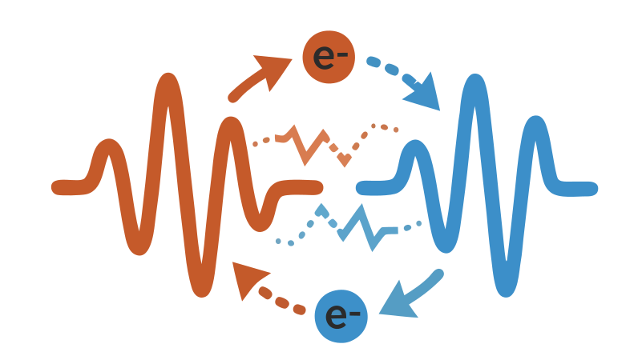
</p>

# RedoxRouter

**A modern, node-based PipeWire patchbay and audio/video routing studio for Linux, written in Rust.**

Created by **ZeroKun265** as a fast, clean, and deeply customizable replacement for `qpwgraph` and `helvum` — built directly on the native `pipewire` Rust bindings (`eframe` / `egui`) without shelling out to CLI tools.

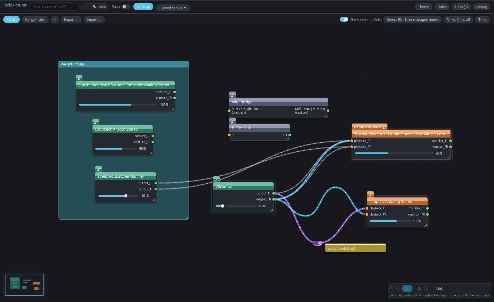

---

## Table of Contents

1. [Core Philosophy: Clean Ownership & Zero Clutter](#core-philosophy-clean-ownership--zero-clutter)
2. [Feature Deep-Dive](#feature-deep-dive)
   - [Interactive Node Canvas & Automatic 3-Column Layout](#1-interactive-node-canvas--automatic-3-column-layout)
   - [Smart Cables: Curved, Zigzag, Waypoints & Inline Switches](#2-smart-cables-curved-zigzag-waypoints--inline-switches)
   - [Stereo Quick-Linking & Format-Safe Port Snapping](#3-stereo-quick-linking--format-safe-port-snapping)
   - [Persistent Saved Links & Deferred Confirmation](#4-persistent-saved-links--deferred-confirmation)
   - [Multiple Setups (Tabs), Virtual Editing & Portable Export/Import](#5-multiple-setups-tabs-virtual-editing--portable-exportimport)
   - [Virtual Speaker Sinks & Virtual Microphones](#6-virtual-speaker-sinks--virtual-microphones)
   - [Audio Bleed / Auto-Connection Prevention](#7-audio-bleed--auto-connection-prevention)
   - [Sink Visibility Modes & Selective Unhiding](#8-sink-visibility-modes--selective-unhiding)
   - [Filter & Color Rules Engine + Shared Rule Library](#9-filter--color-rules-engine--shared-rule-library)
   - [Node Nicknames, Stream Volume Sliders & Live Activity Glow](#10-node-nicknames-stream-volume-sliders--live-activity-glow)
   - [Canvas Organization: Grouping Blocks, Markdown Notes & Align/Distribute](#11-canvas-organization-grouping-blocks-markdown-notes--aligndistribute)
   - [Live Theme Editor, Curated Presets, Gradients & Bloom](#12-live-theme-editor-curated-presets-gradients--bloom)
   - [CLI & Hotkey IPC Control](#13-cli--hotkey-ipc-control)
3. [Mouse & Keyboard Shortcuts Reference](#mouse--keyboard-shortcuts-reference)
4. [CLI Reference](#cli-reference)
5. [Configuration & Storage Files](#configuration--storage-files)
6. [Installation](#installation)
7. [Building from Source](#building-from-source)
8. [AI Usage](#ai-usage)

---

## Core Philosophy: Clean Ownership & Zero Clutter

Traditional PipeWire patchbays dump every internal session-manager connection onto the screen at once, tangling your custom routing with dozens of default WirePlumber links.

**RedoxRouter separates *your* routing from the system's background plumbing:**

- **Owned Links vs. External Links**: Connections you create inside RedoxRouter are **owned** by RedoxRouter. By default, only your owned links are drawn on the canvas, keeping your workspace crystal clear.
- **Clean Exit Lifecycle (with Per-Link Linger)**: Links and virtual devices created by RedoxRouter default to `object.linger = false` — when you close RedoxRouter, PipeWire automatically cleans them up so your system returns to normal. If you want specific routes to stay alive even after quitting, you can mark individual links as **Keep after quit (`linger`)**.
- **On-Demand External Link Inspection & Takeover**: Toggle **Show external links** in the top bar to inspect connections made by WirePlumber or other tools. If you drag a cable between two ports that another program already connects, RedoxRouter prompts you to either **Show as visible only** or **Make Redox connection** (atomically destroying the external link and replacing it with a managed RedoxRouter link).

---

## Feature Deep-Dive

### 1. Interactive Node Canvas & Automatic 3-Column Layout

New nodes are automatically sorted into three logical columns based on their PipeWire `media.class`:
- **Column 0 (Left — Sources / Outputs)**: Microphones (`Audio/Source`), virtual mics (`Audio/Source/Virtual`), webcams (`Video/Source`), and application playback streams (`Stream/Output/Audio`).
- **Column 1 (Middle — Bridges / Filters)**: MIDI bridges (`Midi/Bridge`) and intermediate processing nodes.
- **Column 2 (Right — Sinks / Inputs)**: Hardware speakers/headphones (`Audio/Sink`), virtual sinks, and application recording/capture streams (`Stream/Input/Audio`).

**Composite Persistence Keys**: Nodes are saved using a composite key (`"{node.name}|{media.class}"`). Applications like Discord or browsers that spawn both a playback stream (`WEBRTC VoiceEngine|Stream/Output/Audio`) and a capture stream (`WEBRTC VoiceEngine|Stream/Input/Audio`) under the exact same `node.name` maintain completely independent canvas positions, manual widths, nicknames, visibility states, and custom colors.

---

### 2. Smart Cables: Curved, Zigzag, Waypoints & Inline Switches

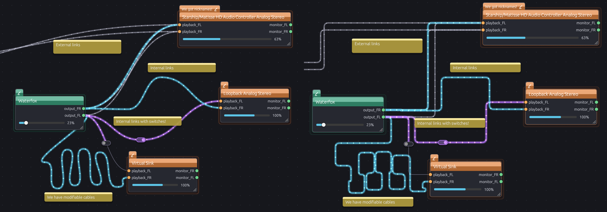

- **Curved & Zigzag Cable Styles**: Switch per-setup between smooth adaptive cubic Bezier **Curved cables** and orthogonal **Zigzag cables** with rounded quadratic corners and automatic lane staggering (so parallel cables between the same nodes don't overlap).
- **Custom Cable Waypoints**:
  - **Double-click** anywhere along an owned cable (or right-click it and choose **Add waypoint here**) to insert a routing waypoint.
  - **Drag** waypoints to route cables cleanly around nodes.
  - **Double-click** a waypoint handle to remove it, or right-click the cable and choose **Clear waypoints**.
- **Inline Switch Cables**:
  - Right-click any owned cable and select **Make switch** (or tick `switch` in the **Saved links** window) to attach an interactive **ON/OFF toggle switch** directly onto the cable.
  - **Visual Signal Flow**: The first half of a switch cable (from the output port up to the switch box) stays lit and animated with flowing dots, showing signal arriving at the switch. When toggled **ON**, the second half lights up and flows into the destination port. When toggled **OFF**, the live PipeWire link is severed while the cable remains on screen with a dimmed second half, ready to be toggled back on with a single click.
  - **Draggable Switch Placement**: Drag the switch box anywhere on the canvas to position your switches like a physical control board, or right-click the switch and select **Reset switch position** to snap it back to the cable's midpoint.
  - **Coupled Stereo Switches & Synchronization**:
    - When adding a switch to a stereo connection (e.g., `FL` and `FR`), RedoxRouter automatically detects the companion channel and prompts to **Couple Stereo Switch** with 1 click.
    - Coupled switches display channel indicators (`L` and `R`) and are tethered by a visual `🔗` stereo bridge. Clicking either switch toggles both channels in lockstep, and dragging either switch moves both in sync.
    - Right-clicking gives options to toggle both channels, decouple into independent single switches, or remove both.
    - When disconnecting or deleting a stereo connection (via right-click or `Delete` key), RedoxRouter prompts you to choose whether to **Disconnect Both (Stereo)** or **Disconnect This Channel Only** (and decouple).

---

### 3. Stereo Quick-Linking & Format-Safe Port Snapping

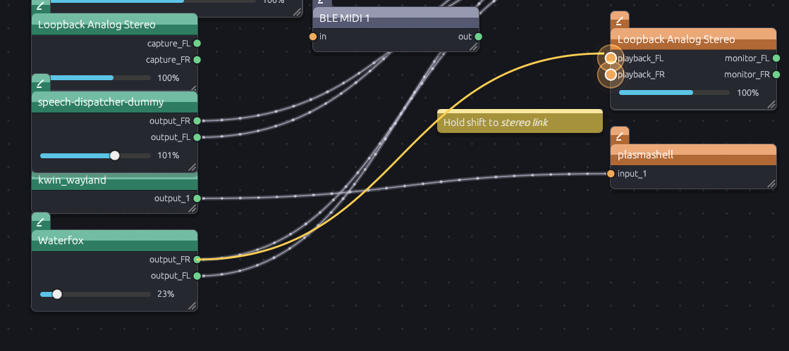

- **Port Snap Ping Animation**: When dragging a cable from a port, compatible target ports within snapping range display an expanding, fading sonar ring in the target port's color.
- **Shift + Drag Stereo Linking**: Hold `Shift` while dragging a cable between stereo ports (e.g., `output_FL` -> `playback_FL`, `_L`/`_R`, `_1`/`_2`, or `Left`/`Right`). Both target ports pulse simultaneously, and releasing the mouse connects both left and right channels at once.
- **One-Click Node Stereo Menu**: Right-click any node with output ports and hover **Connect stereo to…** to connect all matching stereo/multi-channel pairs to any compatible destination node in one click.
- **Format & Media-Type Safety**: RedoxRouter inspects media types (`Audio`, `Video`, `Midi`) before snapping or linking. Incompatible ports (such as an audio stream and a MIDI port) will never snap or trigger format-negotiation loops.

---

### 4. Persistent Saved Links & Deferred Confirmation

- **Automatic Reconnection**: Every owned connection is saved by node and port name (`out_node:out_port -> in_node:in_port`). Whenever an application launches or a USB interface is plugged back in, RedoxRouter automatically restores its links.
- **Deferred Link Persistence**: Connections are only added to your saved links *after* PipeWire confirms the link was successfully created and negotiated, preventing failed links from being saved.
- **Saved Links Manager**: Open the **Links (n)** window from the top bar (or `Tools -> Saved links`) to view all saved connections in the current setup, see their live status (`connected`, `switched off`, `ready`, or `waiting for nodes`), toggle `enabled`, `switch`, or `linger`, or remove links.

---

### 5. Multiple Setups (Tabs), Virtual Editing & Portable Export/Import

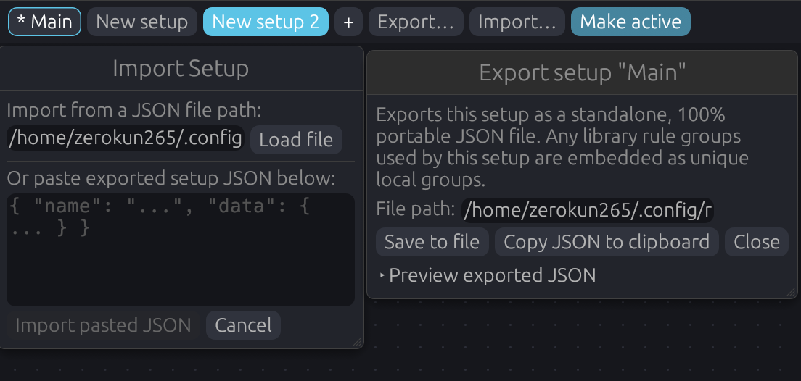

- **Setups as Tabs**: Create multiple independent setups in the second top bar (e.g., `* Main`, `Streaming`, `Gaming`, `Podcast`). Each setup stores its own node positions, manual widths, nicknames, hidden nodes, filter rule groups, saved links, virtual devices, sticky notes, grouping blocks, cable style, snap setting, and bleed prevention mode. Click `+` to start a fresh setup (copying node layout and rules without links or virtual devices), or right-click a tab -> **Duplicate** to clone a setup along with its links and virtual devices.
- **Live vs. Virtual Editing**:
  - The **Active Setup** (marked with `*` and an accent pill border) controls live PipeWire connections and virtual devices.
  - Clicking another tab views that setup in **Virtual Mode**: you can freely arrange nodes, edit rules, and connect/disconnect virtual saved links without interrupting your live audio!
  - Click **Make active** in the tab bar to hot-swap setups in-process: RedoxRouter tears down owned links and virtual devices not used by the new setup, spawns the new setup's virtual sinks/mics, and connects its saved links.
- **100% Portable Setup Export & Import**:
  - Click **Export…** (or right-click any setup tab -> **Export…**) to save a setup to `~/.config/RedoxRouter/exports/<name>.json` or copy its JSON to the clipboard.
  - Any shared library rule groups referenced by the exported setup are automatically embedded as standalone local rule groups with deduplicated names, making exported files 100% self-contained across machines.
  - Click **Import…** to load a setup from your `exports/` directory, a file path, or pasted JSON.

---

### 6. Virtual Speaker Sinks & Virtual Microphones

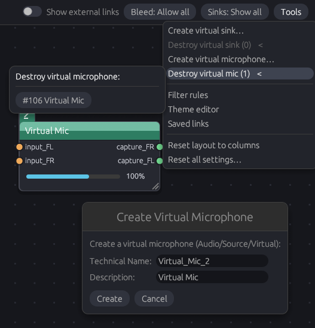

- **Per-Setup Virtual Audio Devices**:
  - **Create Virtual Sink (`Audio/Sink`)**: Creates a stereo virtual speaker (`support.null-audio-sink`) with `playback_FL/FR` input ports and `monitor_FL/FR` output ports — ideal for splitting game, music, and voice chat audio into separate OBS tracks.
  - **Create Virtual Microphone (`Audio/Source/Virtual`)**: Creates a virtual microphone source that applications like Discord, Zoom, or browsers can select as their microphone input in their settings.
- **Automatic Reconciliation**: Virtual sinks and microphones belong to the setup in which they were created (and are also mirrored to `sinks.json`). Switching active setups automatically creates the new setup's virtual devices and destroys those only needed by the old setup.
- **Tools Menu with Left-Opening Hover Flyouts**: Click **Tools** in the tabs bar and hover over **Destroy virtual sink (n)** or **Destroy virtual mic (n)** to open a flyout submenu to the left listing only RedoxRouter-created virtual devices, or right-click a virtual device node on the canvas to destroy it.

---

### 7. Audio Bleed / Auto-Connection Prevention

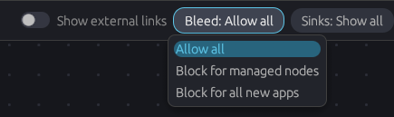

When you route an application into a virtual sink, desktop session managers like WirePlumber often auto-connect that application directly to your hardware speakers as well, causing "audio bleed" (hearing double audio or leaking muted tracks).

RedoxRouter's **Bleed** menu (`Allow all`, `Block for managed nodes`, `Block for all new apps`) uses an **event-based auto-connection filter**:

1. **Allow all**: Normal PipeWire/WirePlumber behavior; no external links are severed.
2. **Block for managed nodes**: When an application that has saved links in your active setup launches (or was already running at RedoxRouter startup), RedoxRouter intercepts and severs the automatic default links WirePlumber creates during the node's first 5 seconds — while keeping any links that match your saved links.
   - If an application is *not* managed when it launches, its default system output link is left untouched — even if you later connect a RedoxRouter cable from it!
   - If you remove all saved links for a node, it immediately stops being treated as managed.
3. **Block for all new apps**: In addition to managed nodes, any new application audio stream launched *after* RedoxRouter starts (outside the initial 3-second startup window) has its initial auto-connections severed so you can route it manually from scratch without sudden audio blasts.
   - **5-Minute Session Memory**: Applications that briefly disappear and reappear within 5 minutes (for example, a browser destroying and recreating its audio stream when pausing/resuming a video) retain their startup `new_app` classification so pre-existing apps aren't mistaken for brand-new apps.
   - **Non-Destructive Mode Switching**: Only newly created auto-links (within 5 seconds of a node appearing) are ever candidates for severing; switching bleed modes or adding a Redox link never deletes pre-existing external links.

---

### 8. Sink Visibility Modes & Selective Unhiding

Use the **Sinks** dropdown in the tabs bar to declutter output sinks:
- **Show all**: Displays all hardware and virtual sinks.
- **Hide Redox only**: Hides virtual sinks created by RedoxRouter while keeping hardware sinks visible.
- **Hide all**: Hides all sink nodes by default — which you can combine with a **Show** rule in the **Rules** window to display only specific sinks you care about.

You can also right-click any individual node and click **Hide node**, then restore hidden nodes anytime from the **Hidden (n)** menu in the tabs bar.

---

### 9. Filter & Color Rules Engine + Shared Rule Library

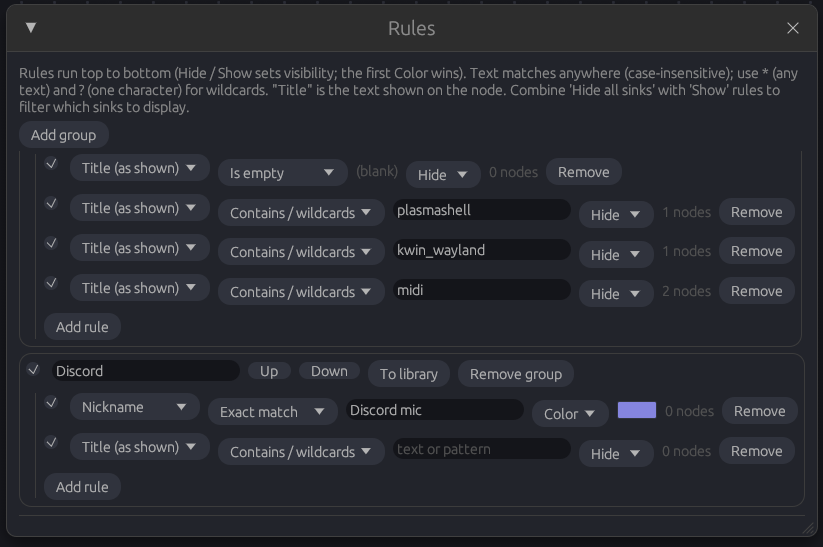

Open the **Rules** window to automate node visibility and header coloring:
- **Fields**: Match against `Title (as shown)`, `Nickname`, `Node name (technical)`, `Node name (exact)`, `Description`, `Media class` (with a live dropdown of currently present classes), or `Any field`.
- **Match Modes**:
  - `Contains / wildcards`: Case-insensitive substring match, or full glob matching when `*` (any run of characters) or `?` (single character) is used (e.g., `?*` on `Nickname` matches every node that has a nickname).
  - `Exact match`: Case-insensitive full-string equality with literal characters.
  - `Is empty`: Matches nodes where the chosen field is blank or whitespace-only.
- **Actions & Precedence**: Rules run top-to-bottom across enabled groups:
  - `Hide` / `Show`: Later rules override earlier ones, allowing you to hide broad categories and selectively `Show` exceptions.
  - `Color`: The **first** matching enabled `Color` rule sets the node's header color.
  - **Manual Colors**: Right-clicking a node on the canvas -> **Color** writes an exact-key rule into a top-priority `"Manual colors"` group so manual per-node colors always win over general filter rules.
- **Rule Groups & Shared Rule Library**:
  - Organize rules into named groups with per-group checkboxes and `Up` / `Down` ordering.
  - Click **To library** on any local group to promote it to `rule_library.json`, sharing it across all your setups.
  - Each setup can reference library groups with its own independent on/off toggle, unlink a library group into a private local copy (**Copy here**), or delete it from the library (which safely converts references in all setups into local copies so no rules are ever lost).

---

### 10. Node Nicknames, Stream Volume Sliders & Live Activity Glow

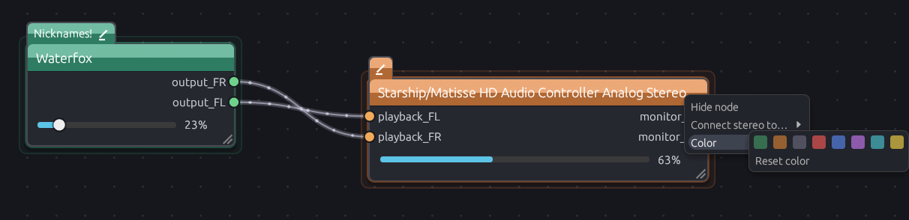

- **Fused Nickname Tab**: Every node has a folder-style tab fused to its top-left corner with a drawn pencil icon. Click the tab to give the node a custom nickname (saved per composite key). Hovering the node's header shows a tooltip with its raw `node.name`, `media.class`, and PipeWire `#id`.
- **Cubic Volume Sliders & Mute**:
  - Application streams (`Stream/*`) feature an interactive volume slider ranging from `0%` to `150%` using a natural cubic gain curve ($\text{gain} = s^3$, matching `wpctl` and desktop mixers).
  - **Drag or click** the slider to adjust gain, **double-click** the slider to reset to `100%`, or **click the percentage label** to toggle mute.
  - Hardware devices (`Audio/Sink`, `Audio/Source`) display a read-only level bar reflecting the sound card's hardware `Route` volume so it always matches your desktop volume applet.
- **Live Audio & Video Activity Glow**:
  - RedoxRouter subscribes to PipeWire node state changes (`pw::node::NodeState::Running`) and audio volume/mute properties.
  - When a node is actively streaming audio (and is unmuted with non-zero volume) or streaming video (such as an active webcam or video capture stream), a slow, faint expanding glow pulses around the node card in a customizable per-column color (Source, Stream, Sink).

---

### 11. Canvas Organization: Grouping Blocks, Markdown Notes & Align/Distribute

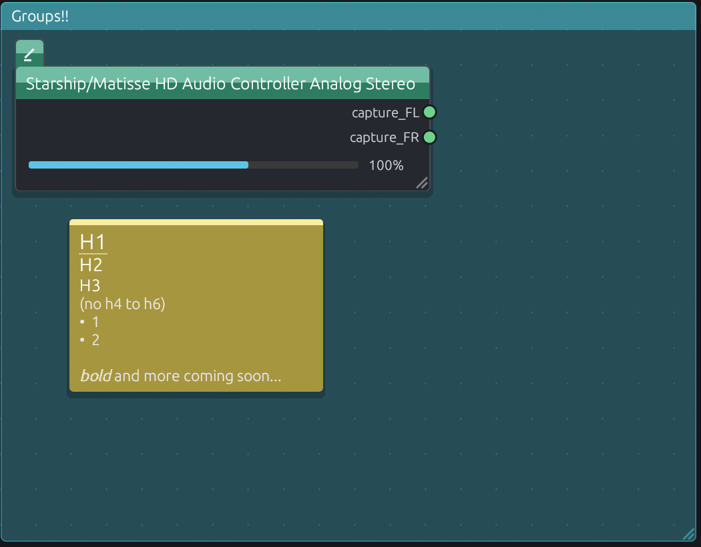

- **Translucent Grouping Blocks**:
  - Right-click empty canvas -> **Add block here** to create a titled, translucent colored background region behind your nodes and cables.
  - Click the block's title bar to select it (`Delete` removes it), drag the title bar to move the block, or **double-click the block's title bar** to automatically select all nodes and sticky notes inside it — dragging the title bar then moves the entire group together!
- **Markdown Sticky Notes**:
  - Right-click empty canvas -> **Add comment here** to place a sticky note above nodes.
  - Click to select (`Delete` removes selected notes), or double-click to edit with rich Markdown formatting: `#` / `##` / `###` headings, `-` / `*` bullet lists, `**bold**`, `*italic*`, `` `inline code` ``, `~~strikethrough~~`, and `\` escapes.
  - Drag the right edge to reflow text width, or right-click to pick from 8 color swatches.
- **Snap-to-Grid & Multi-Node Align/Distribute**:
  - Toggle **Snap** in the top bar to snap dragged nodes, blocks, comments, cable waypoints, and inline switches to the 14 px / 28 px canvas grid.
  - Select 2 or more nodes (via box-select or `Shift+click`) to reveal the **Align / Distribute** toolbar in the bottom-right corner (and in the node right-click menu): **Align Left**, **Align Top**, **Distribute Vertically**, and **Distribute Horizontally**.
- **Node Search (`Ctrl+F`) & Interactive Minimap**:
  - Press `Ctrl+F` or click the top-bar search capsule to search nodes by title, technical name, or nickname; press `Enter` or click a match to center and select the node.
  - Toggle the **Minimap** pill in the top bar to display a borderless, color-coded overview in the bottom-left corner; click or drag inside the minimap to pan across large graphs.

---

### 12. Live Theme Editor, Curated Presets, Gradients & Bloom

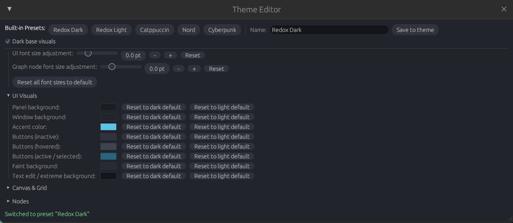

Click **Theme** in the top bar (or `Tools -> Theme editor`) to customize every visual detail with instant live preview:
- **5 Built-in Curated Presets**:
  - **Redox Dark** (Default charcoal & teal)
  - **Redox Light** (Crisp daylight high-contrast palette)
  - **Catppuccin** (Catppuccin Mocha pastel dark palette)
  - **Nord** (Arctic north-bluish palette)
  - **Cyberpunk** (High-contrast neon magenta/cyan palette with line grid and cable gradients enabled)
- **Typography & Font Scaling**:
  - Independently adjust **UI font size delta** and **Graph node font size delta** (`-4 pt` to `+12 pt`) with sliders, `-` / `+` fine-step buttons (`0.5 pt`), and a one-click **Reset font sizes to default** button.
- **Canvas Grid Patterns**: Choose between **Dots**, **Lines** (mesh grid), or **None** per theme.
- **Link Effects (Thickness, Bloom Glow & Smooth Ribbon Gradients)**:
  - Set independent cable thickness (`0.5 px` to `6.0 px`) and **Bloom / Glow Stroke** for Owned, Switch, and External cables (with a **Reset / Enable all bloom** button).
  - Enable hardware-interpolated polyline ribbon **Cable Gradients** (seam-free and facet-free at any zoom or thickness, with flowing dots that smoothly shift color along the gradient) for each cable type, plus a **Disable all gradients** quick button.
  - **Switch Cable Gradient Modes**: Choose **Simple (2 colors)** (interpolating `Start -> Midpoint average at switch -> End`) or **Advanced (4 colors)** (`In -> Switch In` before the switch, `Switch Out -> Out` after the switch).
- **Theme Management & Sharing**: Save multiple custom themes in `~/.config/RedoxRouter/themes/`, update existing themes via **Save to theme**, or export/import theme JSON via files or clipboard.

---

### 13. System Information & Issue Diagnostics (`SysInfo`)

Click **SysInfo** in the top-right bar (or **Tools -> System info / issue report…**, or inside the **Debug** panel, or **Report…** on any error banner) to open the **System Information & Issue Report** window:
- Captures a complete, structured snapshot of your environment (OS/distro, kernel, desktop session, uptime), RedoxRouter runtime state (active/viewed setup, theme settings, internal tracking sets, bleed state), every PipeWire node and port (including IDs, classes, volumes, routes, and bleed session state), every live PipeWire link with full node/port/link IDs, all setups' saved links and rules, and a **300-entry chronological ring buffer** of recent PipeWire events and commands.
- One-click **Copy Full Report to Clipboard**, **Print to Terminal (stdout)**, or **Save Report** to file makes reporting issues effortless and complete.

---

### 14. CLI & Hotkey IPC Control

While RedoxRouter is running, it listens on a Unix domain socket (`$XDG_RUNTIME_DIR/redox-router.sock`, or `/tmp/redox-router.sock`). You can bind desktop keyboard shortcuts, window manager bindings (Hyprland, Sway, i3, KDE, GNOME), or Stream Deck buttons to switch setups or spawn virtual devices on the fly without touching the mouse.

---

## Mouse & Keyboard Shortcuts Reference

| Action | Input / Shortcut |
| :--- | :--- |
| **Pan canvas** | `Middle-click + drag` on canvas, or click/drag inside the **Minimap** |
| **Zoom canvas** | `Scroll wheel` or trackpad pinch (zooms around cursor) |
| **Box-zoom to area** | `Ctrl + Left-click drag` on empty canvas |
| **Fit all nodes to view** | `F` or `Home` key, or click **Fit** in the top navigation capsule |
| **Reset zoom to 100%** | Click **100%** in the top navigation capsule |
| **Search & jump to node** | `Ctrl + F` (type query, press `Enter` or click a match) |
| **Connect ports (mono)** | `Left-click drag` from an output port to an input port (or vice versa) |
| **Connect stereo pair** | `Shift + Left-click drag` between stereo ports (`FL`/`FR`, `L`/`R`, `1`/`2`) |
| **Select node / note / block / link** | `Left-click` (hold `Shift` to add to selection) |
| **Box-select items** | `Left-click drag` on empty canvas (`Shift + drag` adds to selection) |
| **Delete selected items** | `Delete` key removes selected link(s), sticky notes, and blocks |
| **Add / remove waypoint** | `Double-click` an owned cable to add; `Double-click` a waypoint to remove |
| **Toggle inline switch** | `Left-click` the switch box on a switch cable (`Drag` to reposition) |
| **Select & move block contents** | `Double-click` a block's title bar, then `Drag` the title bar |
| **Resize node / block / note** | `Drag` bottom-right corner grip (double-click node grip for auto-width) |
| **Edit node nickname** | `Left-click` the top-left tab above a node (`Enter` saves, `Esc` cancels) |
| **Adjust stream volume** | `Drag` or `click` slider; `Double-click` slider = `100%`; `Click %` = mute |

---

## CLI Reference

```bash
# Launch the RedoxRouter GUI
redox-router

# List all setups in the running instance (* marks the active setup)
redox-router --list-setups
redox-router -l

# Activate a specific setup by name (case-insensitive fallback)
redox-router --activate "Streaming"
redox-router -a Gaming

# Cycle to the next or previous setup and make it active (great for hotkeys!)
redox-router --next-setup
redox-router --prev-setup

# Create a virtual speaker sink on the active setup
redox-router --create-sink "Game_Audio" "Game Audio Sink"

# Create a virtual microphone on the active setup
redox-router --create-mic "Voice_Bus" "Filtered Voice Mic"

# Show CLI help
redox-router --help
```

Set `REDOX_DEBUG=1` in the environment (`REDOX_DEBUG=1 redox-router`) to print PipeWire registry, link lifecycle, and command diagnostics to stderr.

---

## Configuration & Storage Files

All configuration is saved atomically (via temporary file + rename) under `~/.config/RedoxRouter/`:

| Path | Purpose |
| :--- | :--- |
| `~/.config/RedoxRouter/setups.json` | All setups (tabs), which setup is active, and each setup's layout, links, rules, notes, and virtual devices |
| `~/.config/RedoxRouter/rule_library.json` | Shared filter/color rule groups available across all setups |
| `~/.config/RedoxRouter/sinks.json` | Active virtual speaker sinks and virtual microphones |
| `~/.config/RedoxRouter/theme.json` | Currently active visual theme |
| `~/.config/RedoxRouter/themes/*.json` | Saved & imported user themes shown under **My Themes** |
| `~/.config/RedoxRouter/exports/*.json` | Portable exported setup files |

---

## Installation

### Arch Linux (Manual Pacman Package / AUR)

> [!NOTE]
> New user registrations on the official AUR are temporarily suspended by Arch Linux maintainers due to ongoing attacks. As soon as registrations reopen, official AUR packages (`redox-router-bin` / `redox-router`) will be published.
>
> In the meantime, you can build and install a clean, pacman-managed package using the included `PKGBUILD`:

```bash
# Option A: Build from source with makepkg (registered with pacman)
git clone https://github.com/ZeroKun265/redox-router.git
cd redox-router/extra/aur/redox-router
makepkg -si

# Option B: Install precompiled binary with makepkg (fastest)
cd redox-router/extra/aur/redox-router-bin
makepkg -si
```

This installs `redox-router` into `/usr/bin/` with system desktop entry and icons, and tracks it under `pacman` so you can cleanly query or remove it with `sudo pacman -R redox-router`.

*(Once AUR registrations reopen, standard `yay -S redox-router-bin` will be enabled).*

### Precompiled Binary (Universal Linux)
Prebuilt tarballs with `.desktop` and icon integration are available on the [GitHub Releases](https://github.com/ZeroKun265/redox-router/releases) page.

```bash
# 1. Download and extract the latest release
tar -xzf redox-router-x86_64-linux.tar.gz
cd redox-router-*

# 2. Run directly:
./redox-router

# 3. (Optional) Install system-wide or for current user:
sudo ./extra/install.sh       # Installs to /usr/local
# or
./extra/install.sh --user     # Installs to ~/.local

# 4. To uninstall later:
sudo ./extra/uninstall.sh     # Removes from /usr/local
# or
./extra/uninstall.sh --user   # Removes from ~/.local
```

### Cargo Install
If you have a Rust toolchain installed:

```bash
cargo install --git https://github.com/ZeroKun265/redox-router
```

---

## Building from Source

### Prerequisites
- Rust toolchain (`cargo`, `rustc` 2021 edition)
- PipeWire development headers (`libpipewire-0.3-dev` on Debian/Ubuntu, `pipewire-devel` on Fedora, `pipewire` on Arch)
- Build tools: `pkg-config`, `clang` (required for `pipewire-sys` bindgen)

```bash
# Debian / Ubuntu / Pop!_OS
sudo apt install libpipewire-0.3-dev libclang-dev pkg-config

# Fedora / RHEL
sudo dnf install pipewire-devel clang pkgconf-pkg-config

# Arch Linux / Manjaro
sudo pacman -S pipewire clang pkgconf
```

### Build & Run
```bash
# Clone the repository
git clone https://github.com/ZeroKun265/redox-router.git
cd redox-router

# Run in release mode (recommended for smooth 60 FPS canvas rendering)
cargo run --release

# Run the unit test suite (80 unit tests)
cargo test
```

---

## AI Usage
The project does heavy use of AI code generation via various services and models, be warned if you are against it. You are free to create a version of this software that has no AI use whatsoever, this is mostly a project for myself because i couldn't find any good alternatives, and i don't even know how long i will maintain it for, thank you for your understanding.
